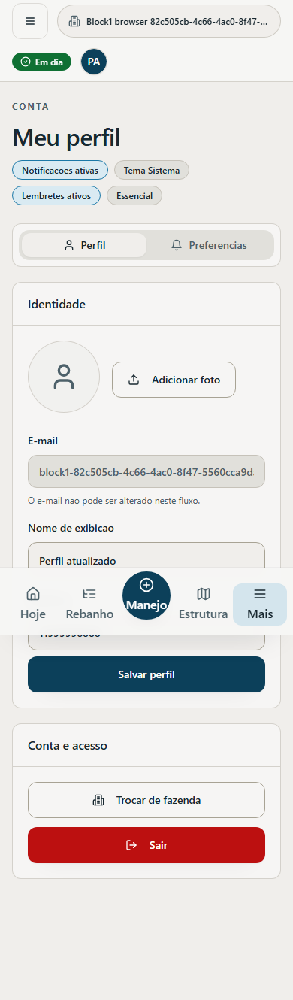

# Perfil pessoal e preferências

Atualizado em: 2026-11-21

**Disponibilidade:** capítulo da versão do Bloco 1 validada localmente, ainda pendente de integração e publicação. Consulte o [estado do projeto](../../context/PROJECT_STATUS.md#estado-atual).

## Para que serve e onde encontrar

Abra **Meu Perfil**. A tela **Meu perfil** tem as abas **Perfil** e **Preferencias**. Esses dados pertencem à sua conta, inclusive quando você troca de fazenda. O nome da propriedade no cabeçalho não transforma preferências pessoais em configurações da fazenda.

## Quem pode usar

Cada pessoa autenticada pode manter o próprio perfil e preferências. Proprietário, gerente e operador não recebem, por seu papel na fazenda, autorização para editar o perfil de outra identidade.

## Como atualizar nome e telefone

1. Abra a aba **Perfil** e confira o **E-mail** exibido.
2. Preencha **Nome de exibicao** e **Telefone** conforme necessário.
3. Selecione **Salvar perfil** e aguarde **Perfil atualizado com sucesso**.
4. Reabra ou recarregue a tela para conferir os valores, se necessário.

O perfil complementar pode estar inicialmente vazio mesmo que você tenha informado nome e telefone no cadastro da conta. O primeiro salvamento cria esse perfil; os seguintes atualizam a mesma pessoa.

O email não pode ser alterado nesse fluxo. Nome e telefone do Perfil são dados de apresentação/contato: não mudam a identidade de entrada, não confirmam telefone e não concedem acesso a fazendas ou convites destinados a outra pessoa.

## Como escolher a aparência

Na aba **Preferencias**, escolha **Sistema**, **Claro** ou **Escuro** e use **Salvar preferencias**. A preferência acompanha sua conta nas propriedades.

No modo Sistema, uma mudança de aparência do sistema operacional com a página já aberta pode exigir recarga para aparecer. Essa limitação permanece pendente; não significa que o tema salvo seja de outra fazenda.

## Como configurar notificações

1. Em **Notificacoes gerais**, escolha se os avisos ficam habilitados.
2. Confira **Lembretes de agenda** e as categorias sanitárias exibidas: **Criticos e atrasados**, **Obrigatorios do dia**, **Proximo procedimento** e **Janela antecipada**.
3. Algumas categorias ficam indisponíveis no modo Essencial. Isso não cria um canal adicional nem garante aviso para toda situação.
4. Em **Antecedencia dos lembretes**, selecione as janelas disponíveis de 7, 3 e 1 dia. Pelo menos uma janela permanece selecionada.
5. Selecione **Salvar preferencias** e aguarde **Preferencias atualizadas com sucesso**.

O fluxo sanitário inspecionado mostra avisos dentro da aplicação, quando há plano derivado de pendências elegíveis. Não há promessa de push, SMS, email ou disparo contínuo com o app fechado. Preferência salva não significa aviso efetivamente entregue nem tarefa executada.

## Como configurar o horário de silêncio

Habilite **Horario de silencio** e preencha **Inicio** e **Fim** com horários válidos e diferentes, na referência local do dispositivo. Por exemplo, **22:00** a **06:00** atravessa a meia-noite e é permitido. Horários iguais não significam silêncio de 24 horas: são rejeitados. Início ou fim vazio impede salvar e mostra o erro junto aos campos.

Confira o intervalo depois de salvar e reabrir a aba. Para desativar o período, desligue **Horario de silencio** e salve. Configurações antigas inválidas são apresentadas sem intervalo ativo; revise e salve uma configuração válida se quiser usar o silêncio.

## Se ocorrer erro

Se o perfil não carregar, use **Tentar carregar perfil** antes de editar/salvar. Ausência inicial de perfil é diferente de falha de carregamento.

Em erro de gravação, o formulário mantém o rascunho na tela; confira conexão e mensagem antes de tentar novamente. Não há sucesso sem confirmação da linha gravada. Se a mensagem indicar mudança de sessão, recarregue e confira sua conta. Anote alterações importantes antes de sair: recuperação do rascunho após navegação ou recarga não é garantida.

## Limitações e referência visual

A tela oferece foto, mas upload, substituição e recuperação de avatar não foram certificados neste recorte. Este capítulo não os apresenta como fluxo validado.

*Perfil em nova sessão de teste, após salvar. A navegação inferior pode encobrir parte do formulário em telas pequenas.* A verificação não certifica todos os aparelhos ou situações de rede.
