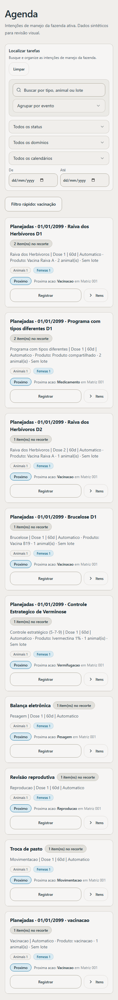
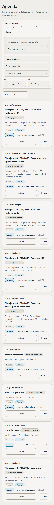
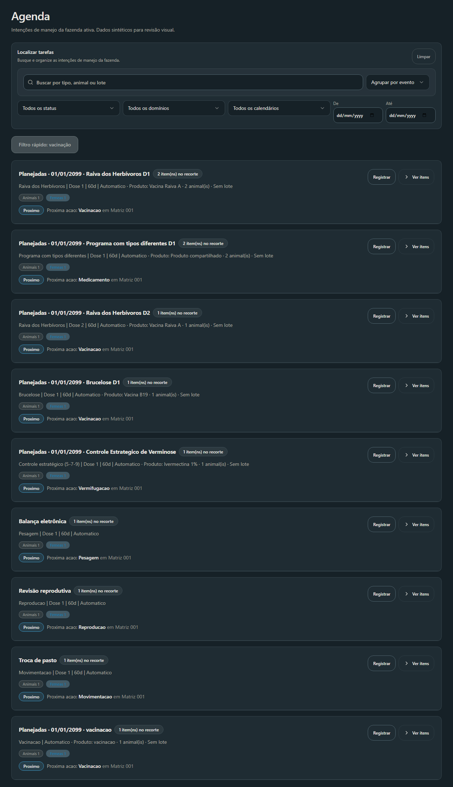
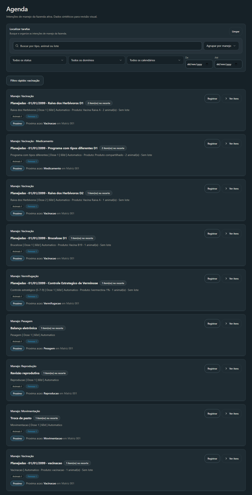

# Agenda Visual V2 — identificação dos tipos de manejo

Atualizado em: 2026-10-21
Baseline confirmado: `fbe162a1f0fdb925011dfcef21e2e267863e6a9c`.
Branch: `codex/agenda-manejo-labels`.

## Diagnóstico e causa

O grupo prioriza protocolo ou produto em `group.title`. A identificação individual usa `AgendaItem.tipo`, mas fica dentro do conteúdo expansível. A recomendação de próxima ação também pode mostrar um tipo, porém não resume grupos mistos e desaparece em tarefas fechadas.

A fonte canônica utilizada pelo patch é exclusivamente `AgendaItem.tipo`. Produto, protocolo, domínio e recomendação não classificam o manejo.

## Correção

- O cabeçalho mostra `Manejo: Vacinação`, `Manejo: Vermifugação`, `Manejo: Pesagem` ou o tipo efetivamente persistido, mesmo recolhido.
- Tipos repetidos são apresentados uma vez. Grupos mistos listam todos os tipos de `group.rows`, inclusive quando um filtro rápido mostra apenas parte das linhas.
- Tipo vazio recebe `Tipo não informado`. Tipos desconhecidos preservam o texto persistido com formatação legível, sem inferência por domínio/produto.
- Protocolo, produto, dose, intervalo, contagens, recomendações e ações existentes permanecem na apresentação original.
- O seletor mostra `Agrupar por manejo`; o valor interno e persistido continua `evento`.

Não houve evidência que justificasse modificar a identidade dos grupos. O fixture misto compartilha uma versão entre tipos distintos para exercitar defensivamente a apresentação; ele não comprova mistura indevida em dados reais. `grouping.ts`, `derivations.ts`, agrupamento por animal, persistência e sincronização permanecem inalterados.

## Arquivos

- `src/pages/Agenda/components/EventGroupCard.tsx`: identificação permanente no cabeçalho.
- `src/pages/Agenda/components/AgendaFiltersToolbar.tsx`: nomenclatura do seletor.
- `src/pages/Agenda/helpers/formatting.ts`: rótulos de apresentação dos tipos persistidos.
- `src/pages/Agenda/__tests__/EventGroupCard.test.tsx`: cabeçalho recolhido, tipos conhecidos/desconhecidos/ausentes/mistos e tarefa cancelada.
- `src/pages/Agenda/__tests__/Agenda.test.tsx`: troca manejo → animal e preservação do valor persistido.
- Este relatório e quatro capturas comparativas.

## Validações observadas

- Baseline: 23 testes aprovados em Agenda, derivations e grouping.
- Bateria focada após o patch: 33 testes aprovados em quatro arquivos. Após acrescentar o caso de tarefa cancelada, os dez testes de `EventGroupCard` passaram; os demais arquivos não mudaram.
- `pnpm run lint`: código zero; um aviso de Fast Refresh no fixture temporário não versionado. ESLint dos cinco arquivos alterados: aprovado sem avisos.
- Prettier dos cinco arquivos alterados: aprovado.
- `pnpm exec fallow audit --gate new-only --changed-since origin/main`: código zero, veredito `warn`; sem novos erros de dependência ou complexidade. Avisos de duplicação entre os cards de animal/manejo e recomendações CSS no toolbar foram registrados, sem alterar configuração ou adicionar supressões.
- `pnpm run build`: aprovado, com aviso de chunks maiores que 500 kB.
- `git diff --check`: aprovado.
- Chromium: 320, 390 e 1280 px, temas claro e escuro; sem overflow horizontal. Navegação com Tab, seleção com teclado e expansão/recolhimento com Enter passaram.
- Nove grupos sintéticos, com tipos, produtos, protocolos, doses e dados parciais: igualdade profunda de chaves, títulos, subtítulos, IDs, linhas visíveis, resumos e ordenação antes/depois nas seis combinações de largura/tema.
- Filtro rápido de vacinação: cinco grupos visíveis; o grupo misto continua identificado como `Vacinação · Medicamento`, com a contagem parcial original. Agrupamento por animal volta a um grupo, preservando seus cards.

O resultado do CI obrigatório e o HEAD final estão registrados no PR DRAFT correspondente. A suíte global fica a cargo do CI; não foi repetida localmente.

## Capturas antes/depois

Componentes reais com dados sintéticos representativos, sem acesso a dados de produção.

| Mobile 390 px, claro — antes          | Depois                                |
| ------------------------------------- | ------------------------------------- |
|  |  |

| Desktop 1280 px, escuro — antes        | Depois                                 |
| -------------------------------------- | -------------------------------------- |
|  |  |

## Riscos residuais e limites

- Rótulos novos ainda não conhecidos pelo formatter são humanizados diretamente do valor persistido, sem tradução ou classificação inferida.
- A validação de navegador exercita componentes e agrupamentos reais com dados sintéticos; não certifica sessão, backend ou execução de manejo.
- A identificação do grupo considera todas as suas linhas, enquanto a contagem existente informa o subconjunto visível quando há filtro rápido.
