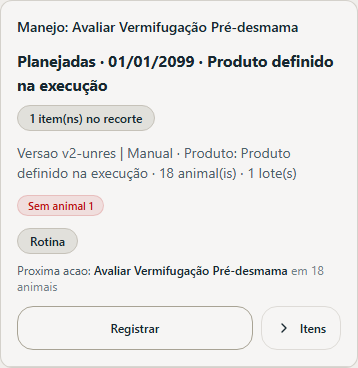
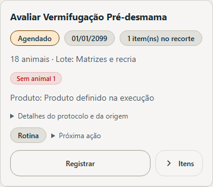
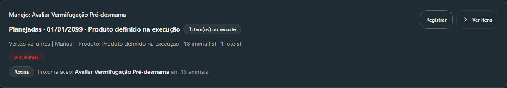
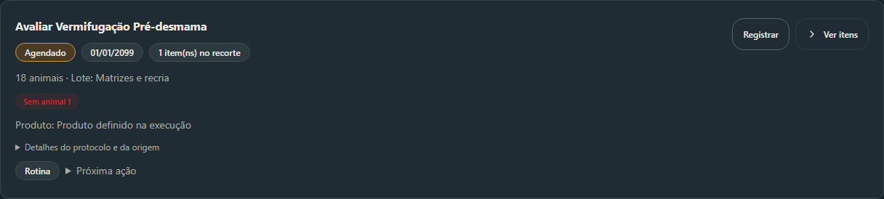
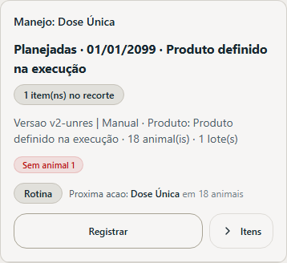
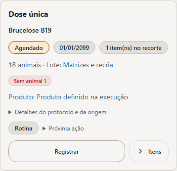
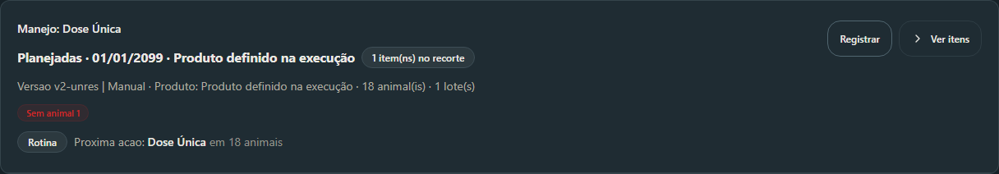
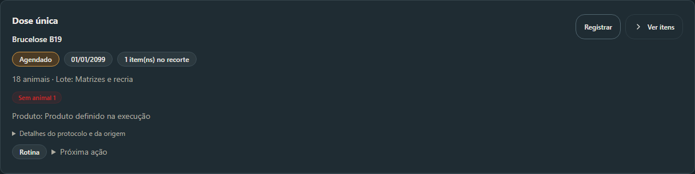

# Agenda V2 — hierarquia de manejos e protocolos

Atualizado em: 2026-10-21.
Baseline visual: PR #237, OPEN/DRAFT, HEAD `9ae8a30c2b640007b70eebd6b967d94c654092d1`.
Base confirmada: `origin/main` em `fbe162a1f0fdb925011dfcef21e2e267863e6a9c`.
Branch reutilizada: `codex/agenda-manejo-labels`.

## Diagnóstico e fontes confirmadas

O PR anterior ainda não está integrado. A `main` não contém a linha `Manejo:` e o HEAD `9ae8a30` contém. A ausência dessa linha na captura citada é compatível com um build anterior, mas não comprova qual build foi usado. O título genérico foi reproduzido também no HEAD atualizado, com dados sintéticos passando pelo adaptador real.

`useAgendaPageData.ts` já adapta o `itemLabel` de metadata/snapshot sanitário V2 para `AgendaItem.tipo`. É essa fonte que contém, por exemplo, “Avaliar Vermifugação Pré-desmama”. O nome canônico do protocolo já chega em `source_ref.protocolo` e `payload.protocolLabel`. O produto vem de snapshot/classe, com fallback “Produto definido na execução”.

`derivations.ts` resolve `row.protocol` pelo catálogo local V1. Um protocolo V2 sem correspondente V1 deixa essa referência nula, apesar de seu nome poder estar disponível no snapshot. `grouping.ts` então usa o produto como título; sua versão técnica pode virar subtítulo. A linha `Manejo:` do patch anterior não corrigia essa prioridade visual.

## Apresentação final

- Título: tipos/ações efetivamente registrados em todas as linhas do grupo. Frases persistidas preservam a escrita, inclusive “Avaliar”, sem convertê-la em aplicação.
- Subtítulo: nome canônico do protocolo, identificação específica, indicação ou dose quando disponíveis, omitindo texto já presente no título. O snapshot V2 é consultado pelas referências já adaptadas; não há consulta adicional nem nome inventado.
- Metadados: situação, data, contagem original de itens, alvo canônico/lote e badges existentes. Produtos e intervalos aparecem como informação secundária.
- Origem, versão e identificação técnica do subtítulo anterior ficam no disclosure “Detalhes do protocolo e da origem”. A recomendação existente fica em “Próxima ação”, com urgência ainda visível. Ambos são operáveis com teclado.
- Tipos heterogêneos continuam explícitos, inclusive quando o filtro rápido exibe só parte do grupo. As ações recebem o novo título como nome acessível; callbacks, IDs e decisões de recomendação são os mesmos.

| Cenário                            | Antes, título principal em `9ae8a30`             | Depois, título / contexto                             |
| ---------------------------------- | ------------------------------------------------ | ----------------------------------------------------- |
| Avaliação pré-desmama              | Planejadas · data · Produto definido na execução | Avaliar Vermifugação Pré-desmama                      |
| Avaliação pré-confinamento         | Planejadas · data · Produto definido na execução | Avaliar Vermifugação Pré-confinamento ou Pasto Vedado |
| Avaliação pré-parto                | Planejadas · data · Produto definido na execução | Avaliar Matrizes Pré-parto                            |
| B19 V2, etapa “Dose única”         | Planejadas · data · Produto definido na execução | Dose única / Brucelose B19                            |
| Vacinação com dose em código       | Protocolo D1                                     | Vacinação / protocolo · D1                            |
| Versão sem nome resolvido          | Produto e versão técnica                         | Ação registrada; versão sob demanda                   |
| Dados sem identificação específica | Produto genérico                                 | Manejo sanitário, conforme fallback já carregado      |

## Arquivos incrementais

- `src/pages/Agenda/helpers/groupPresentation.ts`: composição pura da apresentação, sem modificar os grupos recebidos.
- `src/pages/Agenda/helpers/formatting.ts`: preservação de frases canônicas completas.
- `src/pages/Agenda/components/EventGroupCard.tsx`: hierarquia, metadados e disclosures acessíveis.
- `src/lib/agenda/grouping.ts`: exportação do formatter de fase já existente, para reutilizar doses sem duplicar interpretação; demais diferenças são Prettier. Identidade e agrupamento não mudam.
- Testes de apresentação, card e integração da Agenda; este relatório e capturas. `derivations.ts`, adaptador, agrupamento por animal, geração e execução permanecem intactos.

## Validações observadas

- `pnpm exec vitest run src/pages/Agenda/__tests__/Agenda.test.tsx src/pages/Agenda/__tests__/EventGroupCard.test.tsx src/pages/Agenda/__tests__/groupPresentation.helper.test.ts src/pages/Agenda/__tests__/derivations.helper.test.ts src/pages/Agenda/__tests__/useAgendaPageData.helper.test.ts src/lib/agenda/__tests__/grouping.test.ts`: 6 arquivos, 50 testes aprovados.
- Após os ajustes finais e um caso adicional contra supressão indevida de nomes curtos, os 19 testes dos dois arquivos de apresentação/card passaram.
- ESLint e Prettier dos sete arquivos de código alterados incrementalmente: aprovados.
- `pnpm exec fallow audit --gate new-only --changed-since origin/main --format json`: código 0, veredito `warn`, sem dead code ou complexidade introduzidos. Avisos de duplicação em estruturas já existentes, valores CSS do toolbar e resolução local de `node_modules`; sem supressões ou mudança de configuração. O primeiro achado bloqueante na função nova foi corrigido antes da publicação. A execução Linux também integra Required validation, a conferir após push.
- Chromium: 12 renderizações comparativas, cobrindo 320/390/1280 px, claro/escuro e antes/depois. Sem erros de página ou overflow horizontal. Expansão/recolhimento, filtro rápido, troca manejo/animal por teclado e disclosure técnico com Enter aprovados nas seis combinações.
- Igualdade profunda dos 15 grupos antes/depois: chaves, títulos/subtítulos internos, IDs, linhas visíveis, resumos e ordenação. Filtro vacinação mantém cinco grupos; grupo misto preserva os dois tipos e a contagem parcial `1 de 2`.
- O fixture sanitário V2 utiliza `normalizeAgendaPageData` e `buildAgendaBaseRows` reais, incluindo as três avaliações, B19, produto indefinido, versão sem nome e cancelamento. Complementado por vacinação D1/D2, produtos distintos, grupo misto e outros domínios.
- `git diff --check`: aprovado antes da publicação. Required validation do HEAD publicado: consultar o resultado registrado no PR #237.

## Capturas antes/depois

Componentes reais e dados sintéticos representativos; nenhuma sessão ou base de produção utilizada.

| Pré-desmama — 390 px, claro — antes       | Depois                                    |
| ----------------------------------------- | ----------------------------------------- |
|  |  |

| Pré-desmama — 1280 px, escuro — antes     | Depois                                    |
| ----------------------------------------- | ----------------------------------------- |
|  |  |

| B19 — 390 px, claro — antes        | Depois                             |
| ---------------------------------- | ---------------------------------- |
|  |  |

| B19 — 1280 px, escuro — antes      | Depois                             |
| ---------------------------------- | ---------------------------------- |
|  |  |

## Limites e riscos residuais

- Dados sem nome/ação específica continuam com os fallbacks canônicos já carregados; a interface não consegue recuperar informações ausentes nem as inventa.
- Os resumos e badges de contagem foram preservados. Em itens V2 cujo alvo representa vários animais e `animal_id` é nulo, o badge preexistente “Sem animal” pode coexistir com o alvo canônico “18 animais”; não houve correção da semântica desse resumo neste patch.
- A validação local usa dados sintéticos e não certifica sessão, sincronização, backend ou execução real. Esses fluxos não foram modificados. Não foi executado merge ou deploy.
