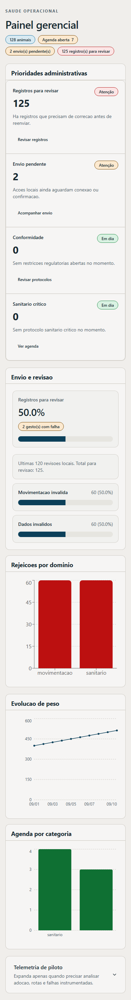
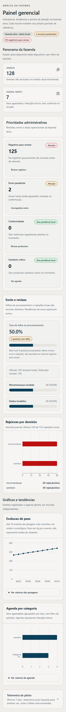
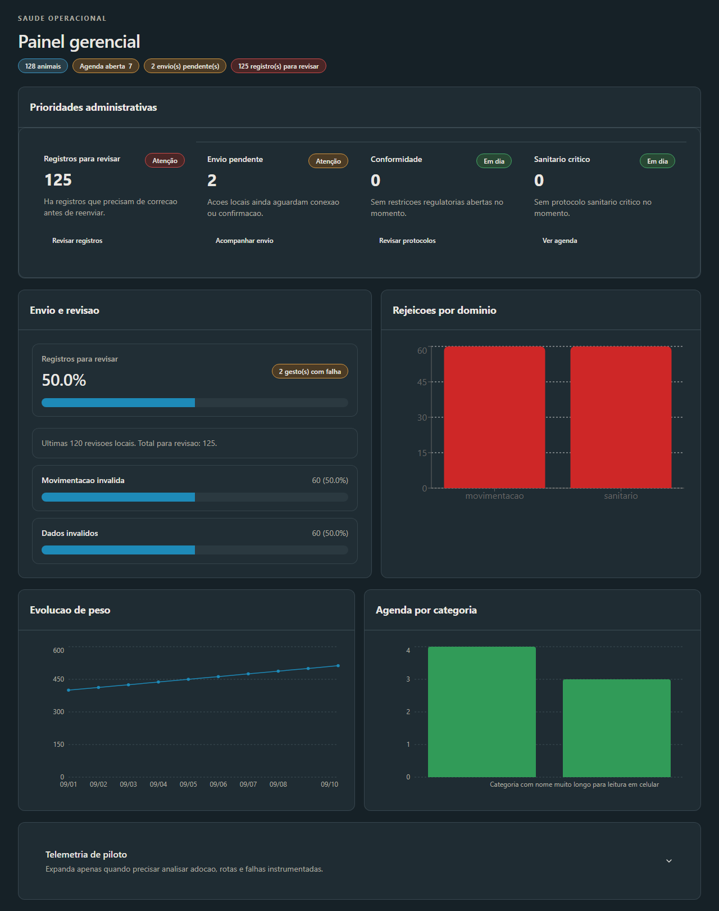
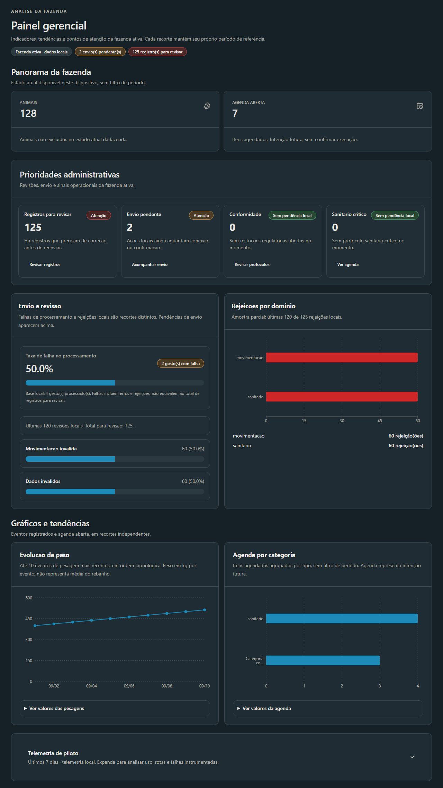

# Dashboard — Visual V2

Atualizado em: 2026-10-21
Baseline: `27a3bed971639c41c0ca458379a6b9b5f02ef8dc` (`origin/main`, PR #233 integrado).
Branch: `codex/visual-v2-dashboard`.

## Diagnóstico e decisões

- Indicadores de rebanho e agenda estavam restritos a badges pequenos. Agora usam os componentes `MetricCard` e `SectionHeader` existentes.
- O cabeçalho informa o recorte da fazenda ativa e a natureza local dos dados. A identificação nominal continua no seletor de fazenda do shell; nenhuma consulta foi acrescentada.
- Gráficos de categorias usam barras horizontais, eixos legíveis e cores do tema. Os valores completos ficam disponíveis também em texto, com detalhes nativos acessíveis por teclado.
- A curva de peso continua representando os dez eventos mais recentes, com peso em kg por evento. O texto explicita que não é média do rebanho.
- Falhas de processamento, rejeições e pendências de envio têm descrições distintas. A amostra de rejeições explicita o limite de 120 registros e o total disponível.
- Leitura pendente, ausência de fazenda, vazio, offline e falha local têm apresentações próprias. O conteúdo é remontado pela chave da fazenda para descartar a visão anterior durante a troca.
- Recortes sanitários mantêm ações e parâmetros, com menos colunas estreitas. Telemetria permanece recolhida e explicita os últimos sete dias.

## Escopo do diff

- `src/pages/Dashboard.tsx`: apresentação, estados de leitura e isolamento visual na troca de fazenda.
- `src/pages/__tests__/Dashboard.test.tsx`: cinco novos cenários de apresentação e recuperação; três cenários anteriores preservados.
- Este relatório e quatro capturas comparativas.

Nenhuma alteração em Home, serviços, fórmulas, consultas, read models, rotas, banco ou implementação de sincronização.

## Preservação dos dados

Comparação dos ASTs antes/depois confirmou igualdade dos nove callbacks de `useLiveQuery`, suas dependências, do efeito de atualização da agenda e dos quatro memos de séries/métricas. A única alteração no memo de prioridades é a descrição do envio sem pendências locais.

No Chromium, com Dexie e Recharts reais e dados sintéticos:

| Recorte                         | Antes                     | Depois   |
| ------------------------------- | ------------------------- | -------- |
| Animais da fazenda A            | 128                       | 128      |
| Agenda aberta A                 | 7                         | 7        |
| Rejeições A                     | 125                       | 125      |
| Envio pendente A                | 2                         | 2        |
| Taxa de falha                   | 50,0%                     | 50,0%    |
| Rejeições por domínio (amostra) | 60 + 60                   | 60 + 60  |
| Série de peso                   | 10 pontos, 400 a 512,5 kg | Idêntica |
| Série da agenda                 | 4 + 3 itens               | Idêntica |

As três propriedades `data` efetivamente recebidas pelo Recharts foram comparadas por igualdade profunda nas seis combinações de largura/tema. Após A → B, a tela mostrou um animal, agenda e pesagens vazias, sem dados de A. Os registros de `queue_gestures` permaneceram idênticos, e a chamada existente de atualização ocorreu uma vez para A e uma vez para B.

## Validações observadas

- Chromium 153: 320, 390 e 1280 px, claro/escuro; séries preenchidas, categoria longa, detalhes dos valores, teclado no accordion, offline e troca A → B. Sem erros de página nos cenários de dados e sem overflow horizontal.
- Chromium 320 px: vazio com Dexie real; loading e erro com suspensão/falha sintética da leitura.
- Chromium nas seis combinações de largura/tema: número de 16 dígitos injetado apenas no fixture, sem overflow; foco em link e abertura dos valores com Enter.
- `pnpm exec vitest run src/pages/__tests__/Dashboard.test.tsx src/components/ui/__tests__/metric-card.test.tsx src/components/ui/__tests__/section-header.test.tsx --reporter=dot`: 18 testes em três arquivos aprovados.
- `pnpm run lint`: código zero.
- `pnpm exec prettier --check src/pages/Dashboard.tsx src/pages/__tests__/Dashboard.test.tsx`: aprovado.
- `pnpm exec fallow audit --gate new-only`: código zero; oito achados herdados excluídos pelo gate existente. Configuração e supressões inalteradas.
- `pnpm run build`: aprovado, com aviso de chunks maiores que 500 kB.
- `git diff --check`: aprovado.
- `pnpm run gates:docs`: aprovado; headers, continuidade e contrato documental coerentes.

O resultado remoto de **Required validation** e o HEAD final devem ser consultados no PR DRAFT correspondente; este relatório registra as evidências locais anteriores à publicação.

## Capturas

Dados sintéticos, mesma fonte local antes/depois. Capturas após a animação dos gráficos.

| Mobile 390 px, claro — antes          | Depois                                |
| ------------------------------------- | ------------------------------------- |
|  |  |

| Desktop 1280 px, escuro — antes        | Depois                                 |
| -------------------------------------- | -------------------------------------- |
|  |  |

## Limites e riscos residuais

- O fixture de navegador substituiu autenticação e transporte de pull; não constitui certificação de backend, sessão real ou ACK remoto. As consultas Dexie e os gráficos reais foram exercitados.
- Os cálculos existentes continuam tratando detalhe de pesagem ausente como zero; essa limitação preexistente foi preservada para respeitar o escopo visual.
- A suíte global será executada pelo Required validation. Os testes locais registraram avisos de migração futura do React Router. Não houve merge, deploy ou operação remota de banco.
